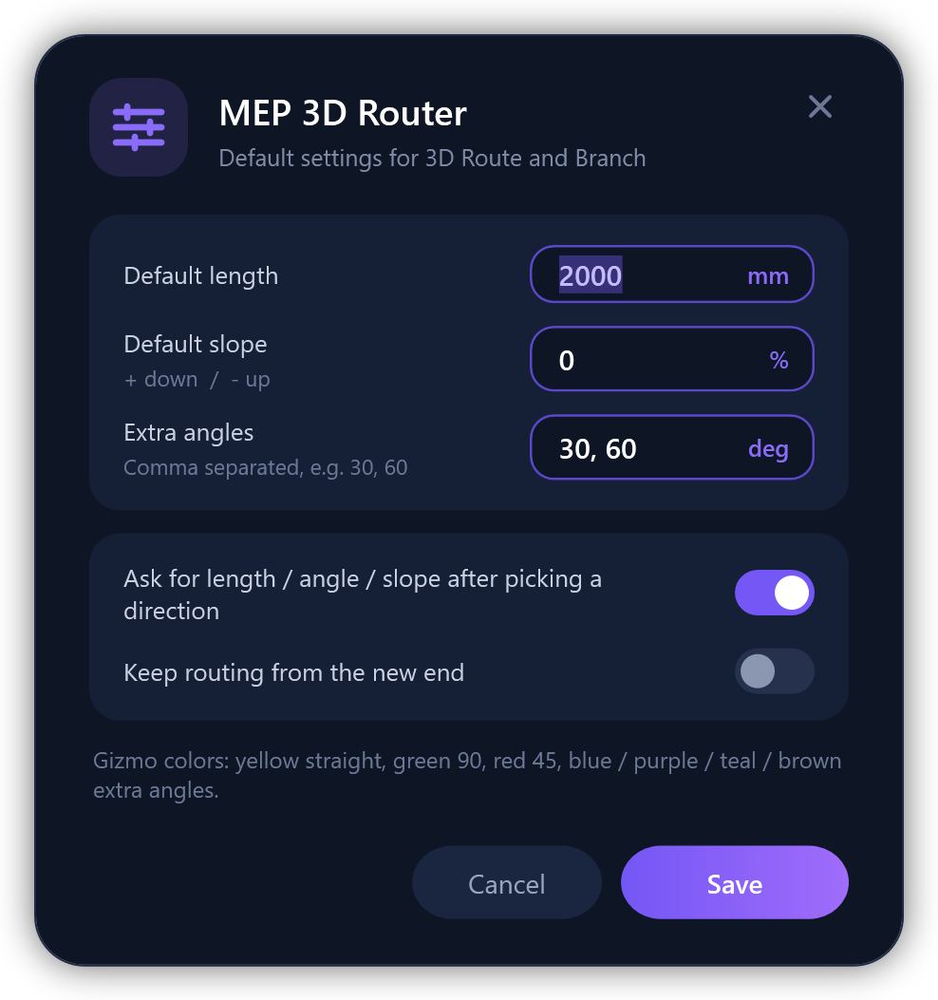
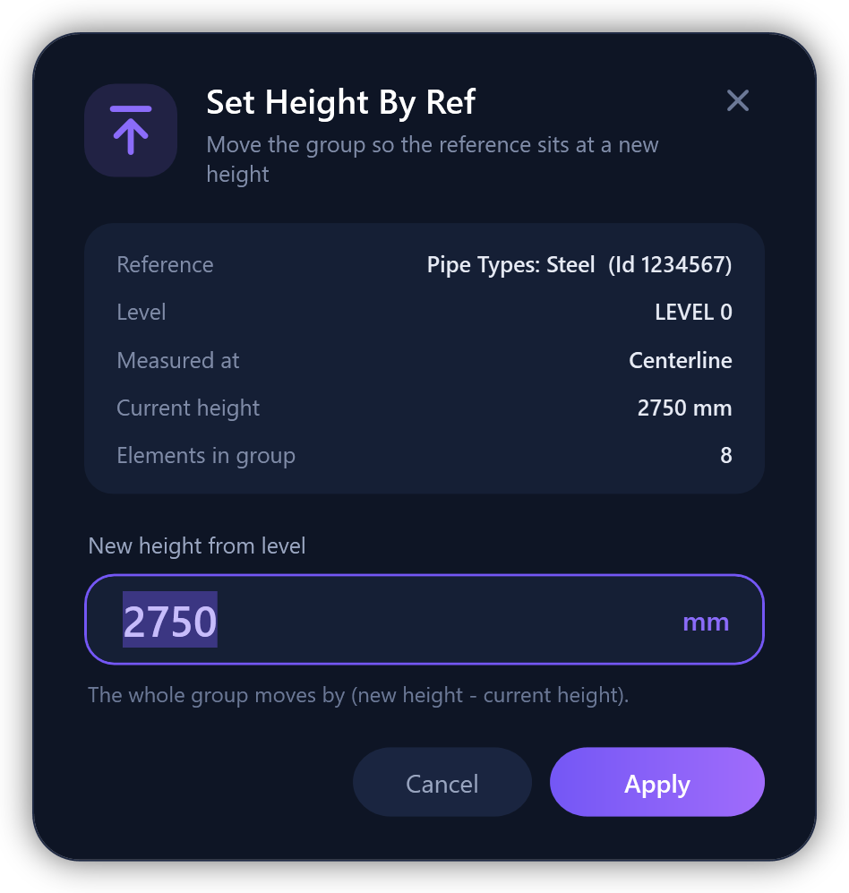
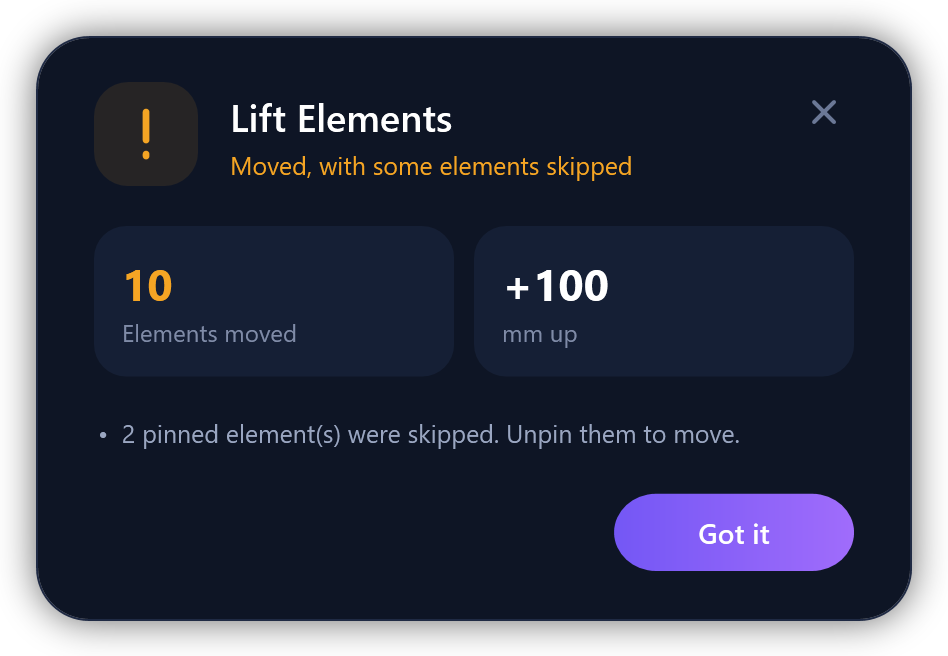

# IronTools

pyRevit extension for MEP work in Revit (tested on pyRevit 7 / Revit 2024).


## What you get

**Iron Tools tab**
- **3D MEP Router**: 3D Route, Branch, Settings
- **Sprinkler Tools**: Align & Connect, Connect Only
- **Modify Tools**: Lift Elements, Set Height By Ref

**Modify tab**: an "Iron Tools" panel with Lift Elements and Set Height By Ref (added automatically by `startup.py`).

## Screenshots

<table>
  <tr>
    <td align="center" width="50%"><b>3D MEP Router: Settings</b><br>Default length, slope and extra angles for 3D Route and Branch.<br><br></td>
    <td align="center" width="50%"><b>Lift Elements</b><br>Move the selection up or down by a set offset, with quick-value chips.<br><br></td>
  </tr>
  <tr>
    <td align="center"><b>Set Height By Ref</b><br>Pick one element as the reference and move the whole group to a new height from its level.<br><br></td>
    <td align="center"><b>Result cards</b><br>Every tool ends with a clear summary: green = done, amber = done with notes, red = failed.<br><br><br></td>
  </tr>
</table>

## Install (recommended, gets updates)

1. Make sure pyRevit is installed.
2. Open PowerShell or Command Prompt and run:

   ```
   pyrevit extend ui IronTools https://github.com/Ahmedzero800/IronTools.git
   ```

3. Open Revit (or click **pyRevit > Reload** if it is open). The **Iron Tools** tab appears.

**To update later:** pyRevit tab > **Update**, or run `pyrevit extensions update IronTools`.

## Install (manual, no updates)

1. Close Revit.
2. Press `Win + R`, type `%APPDATA%\pyRevit\Extensions`, press Enter (create the folder if missing).
3. Download this repo as ZIP (green **Code** button > **Download ZIP**), extract it, and copy the folder into `Extensions`, renamed to `IronTools.extension`.
4. Open Revit.

## Uninstall

```
pyrevit extend remove IronTools
```

Or delete `%APPDATA%\pyRevit\Extensions\IronTools.extension` and reload pyRevit.

---

## طريقة التثبيت

1. لازم يكون pyRevit متسطب.
2. افتح PowerShell واكتب الأمر:

   ```
   pyrevit extend ui IronTools https://github.com/Ahmedzero800/IronTools.git
   ```

3. افتح Revit (أو اعمل **Reload** من تاب pyRevit) هتلاقي تاب **Iron Tools** ظهر.

**للتحديث:** من تاب pyRevit اضغط **Update**.
