# IronTools

pyRevit extension for MEP work in Revit (tested on pyRevit 7 / Revit 2023-2025).

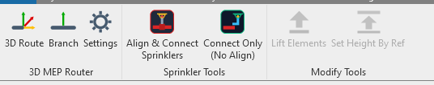

## What you get

**Iron Tools tab**
- **3D MEP Router**: 3D Route, Branch, Settings
- **Sprinkler Tools**: Align & Connect, Connect Only
- **Support Tools**: Support Generator, Re-adjust, Replace Support *(new)*
- **Modify Tools**: Lift Elements, Set Height By Ref
- **Annotation Tools**: Smart Tag
- **View Tools**: Template Manager

**Modify tab**: an "Iron Tools" panel with Lift Elements and Set Height By Ref (added automatically by `startup.py`).

## Support Tools

Pipe supports placed for you, sized to the pipe and fixed to the real structure, with no clashes.

**Support Generator**
- **Along the pipes**: the first support at distance **A** from each pipe end, the rest evenly spread, never more than **B** apart.
- **Click points**: click on the pipes where you want supports. Each click drops an orange marker (click it again to remove it), then press **Esc** to place them all at once.
- Sized to the pipe **and its insulation**, turned across the pipe, and stamped with its pipe so running again does not double them.

**Four mount types**, chosen by the family:

| Mount | Fixed to | How |
|---|---|---|
| Ceiling | Underside of the **concrete** slab or beam above | Rod up; steel joists, finishes and ceilings are ignored |
| Floor | Top of the floor below | Post down; it checks the whole base, not only the centre |
| Wall | Nearest wall beside a horizontal pipe | Bracket turned to face the wall |
| Riser | Nearest wall around a vertical pipe | Clamp / bracket to the wall |

It looks in this model **and every loaded link** (structural or architectural). Every support ends **1 mm before** the concrete, floor or wall, measured on its real 3D geometry (anchors and base plates included), so nothing clashes in Navisworks. After each run a clash check lists and selects any support that still touches structure or a wall (demolished elements are ignored).

**Re-adjust**: moved, resized, re-levelled or split a pipe? Select the pipes (or the supports) and click Re-adjust: the supports slide back onto their pipes, resize and re-fix to the structure.

**Replace Support**: swap supports for another family in one go, at the same spots. Comments, Mark and workset are kept.

**Your support families.** IronTools ships ready settings for a set of round-pipe support families (`lib/support_profiles.json`). The families themselves are not included: choose **Library folder...** in the dialog and point it at the folder with your `.rfa` files. Families whose names match a ready setting appear in the list by themselves (for example `SUP_PIPE_FLR-H_TPost.rfa` shows as *Floor: T-post*). Any other family: **+ Add family...**; the tool guesses which parameters to drive and you check them once. If a project does not have the family yet, it is loaded from the library folder. Everything is one Ctrl+Z.

<p align="center">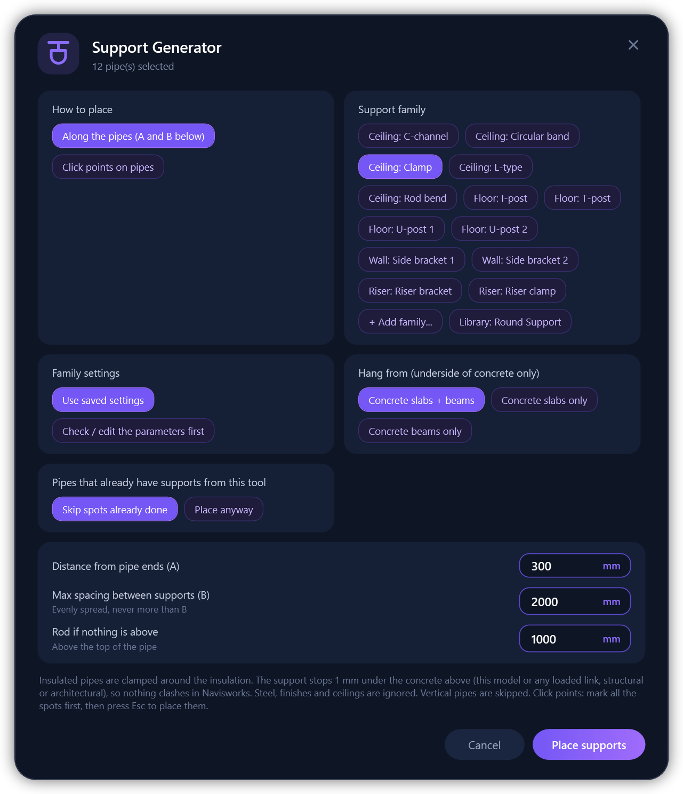</p>
<p align="center">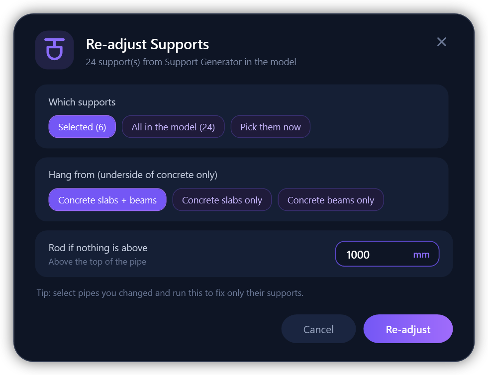 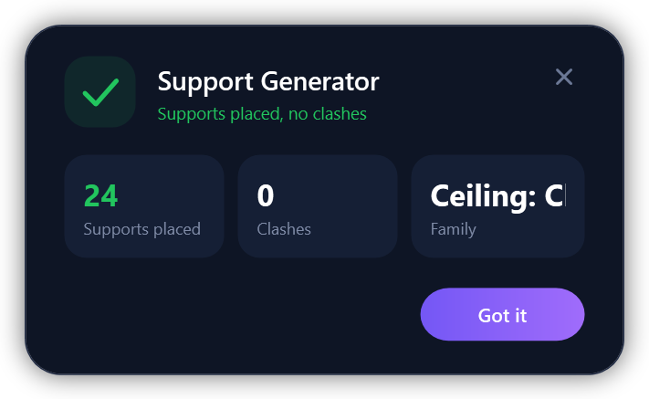</p>

## Smart Tag

Tag a group of elements in one neat, aligned column instead of placing tags one by one.

1. Select the elements (or click the button and pick them).
2. Choose the **leader angle**, the **side** (auto from your click, right or left), a **tag type for each category** in the selection, the gap between tags, and whether to show the **live preview**.
3. Move the mouse: the preview shows where the tags and leaders will go. Click to place them.

Leader angle modes:
- **Free** (default): tags sit exactly where you click; each leader takes the straight line that suits it. Shortest leaders.
- **90°**: straight vertical legs, staggered so they never lie on top of each other.
- **45°**: parallel diagonal legs. If a 45° leg cannot reach without entering the tag column, the column moves out a little to keep the angle exact.

Tags are stacked tight (default gap 0.5 mm on paper) and aligned. The order of the tags is chosen so leaders do not cross and no leader runs through another tag. Works in plans, sections, elevations and locked 3D views (including isometric). Your choices are remembered, and one Ctrl+Z undoes everything.

<p align="center">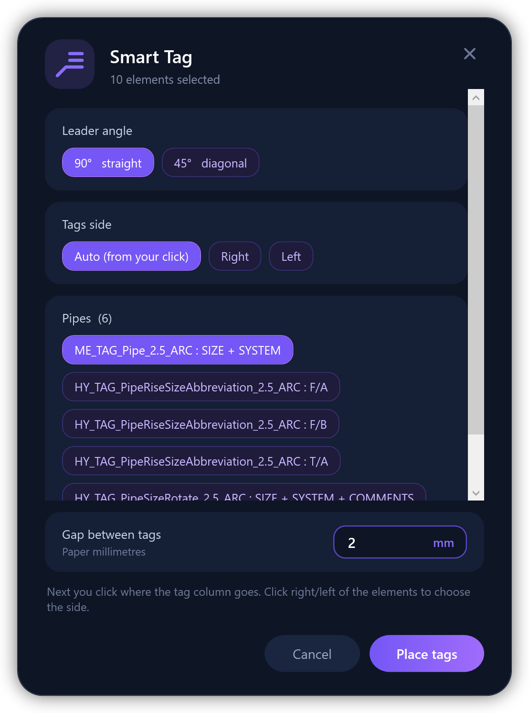</p>

## Template Manager

All view templates of the project in one window.

- **List**: search by name, *Only used* filter, view type, and how many views use each template (click the number to select those views).
- **Settings**: tick which settings the template controls, grouped like Revit's dialog, with search and *Only controlled*. Select several templates to change them together: a grey tick means "only some", and values that differ show `*VARIES*`.
- **Accept / Discard**: renames and ticks wait for *Accept* (an orange dot marks templates with changes).
- **Copy / Paste settings**: copy chosen settings from one template to one or many others, including **V/G overrides, filters (same order and colours), view range and worksets**, optionally with the *Controlled by template* flags. Settings the target view type does not have are skipped and counted.
- **Duplicate / Delete** (delete asks first and tells you how many views lose their template). Every action is one Ctrl+Z in Revit.

<p align="center">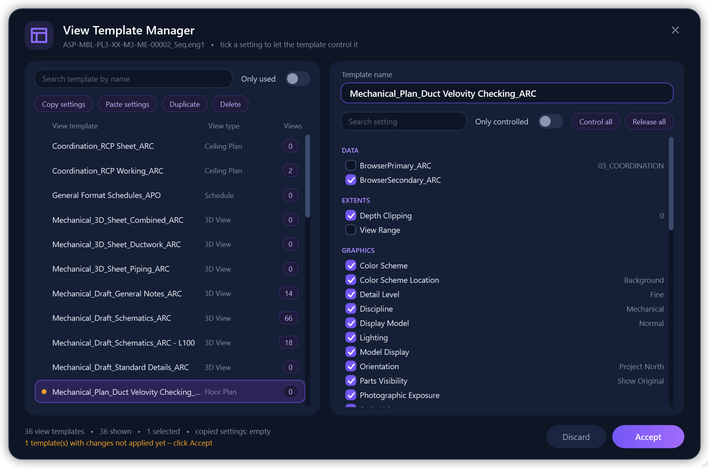</p>
<p align="center">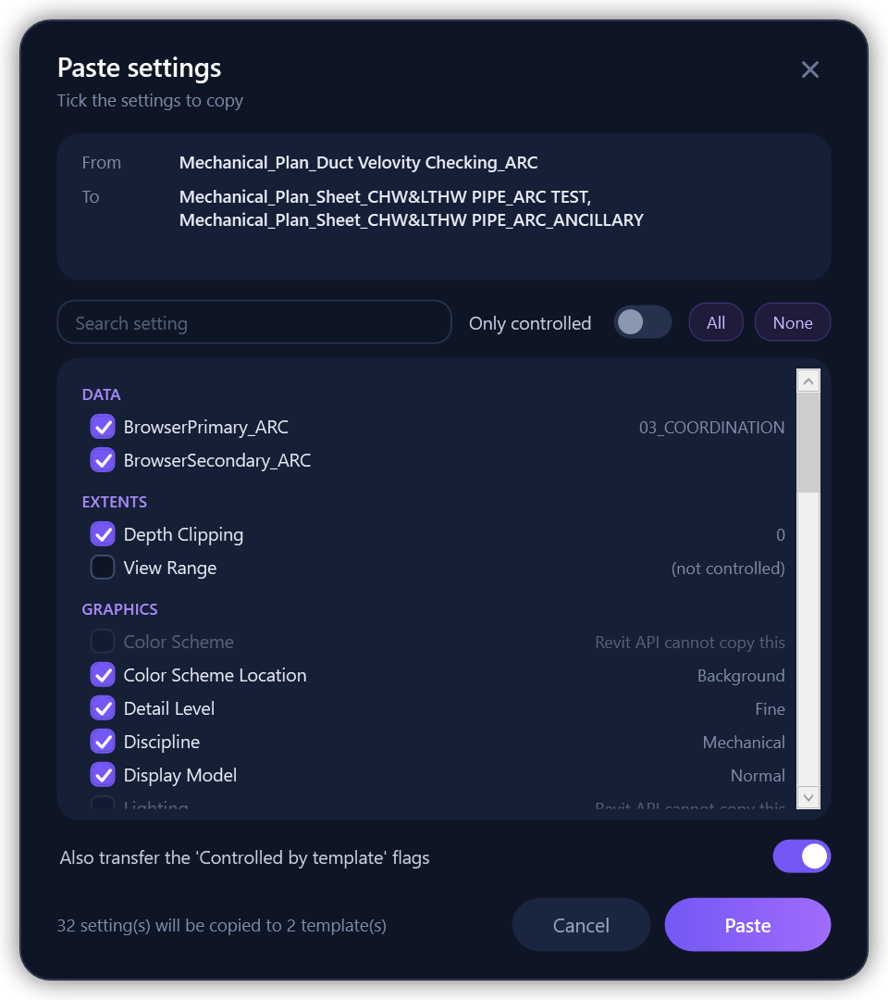</p>

## Screenshots

<table>
  <tr>
    <td align="center" width="50%"><b>3D MEP Router: Settings</b><br>Default length, slope and extra angles for 3D Route and Branch.<br><br></td>
    <td align="center" width="50%"><b>Lift Elements</b><br>Move the selection up or down by a set offset, with quick-value chips.<br><br>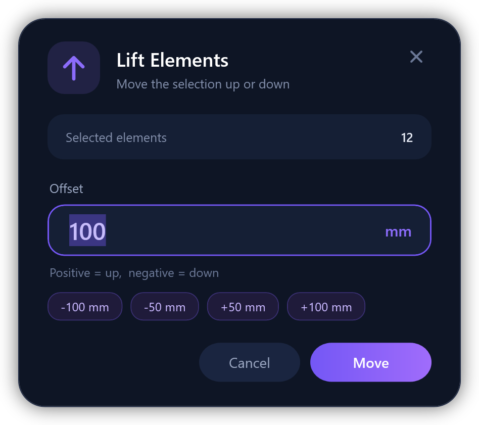</td>
  </tr>
  <tr>
    <td align="center"><b>Set Height By Ref</b><br>Pick one element as the reference and move the whole group to a new height from its level.<br><br></td>
    <td align="center"><b>Result cards</b><br>Every tool ends with a clear summary: green = done, amber = done with notes, red = failed.<br><br>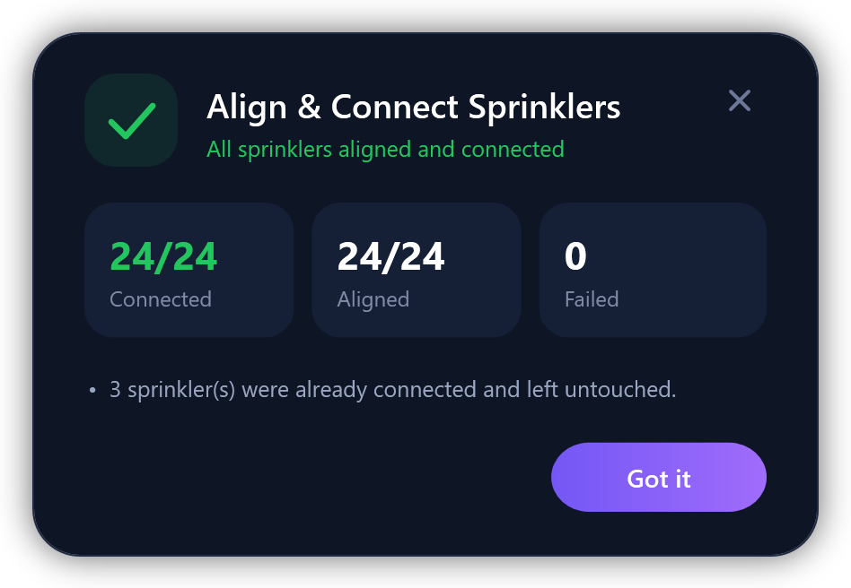<br></td>
  </tr>
</table>

## Install

You need **[pyRevit](https://github.com/pyrevitlabs/pyRevit/releases)** installed. That's all.

1. **Close Revit.**
2. Download **[IronTools-Setup.exe](https://github.com/Ahmedzero800/IronTools/releases/latest/download/IronTools-Setup.exe)** and open it.
3. Click **Install**. When every step is green, you're done.
4. Open Revit: the **Iron Tools** tab is there.

> **"Windows protected your PC"?** The setup is not code-signed yet, so Windows asks first.
> Click **More info**, then **Run anyway**. It only installs IronTools into your pyRevit folder,
> and you can read its [source code](installer/IronToolsSetup.cs).

<table>
  <tr>
    <td align="center" width="50%"><b>1. Click Install</b><br><br>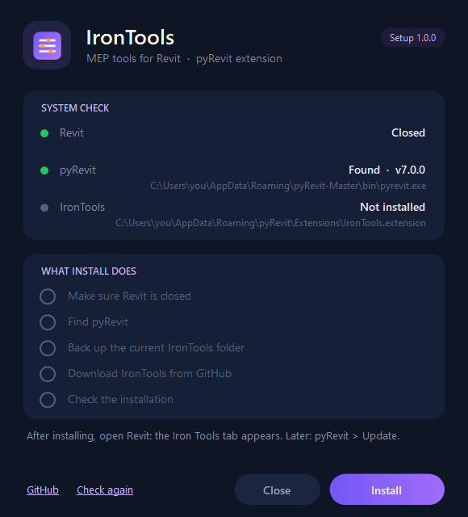</td>
    <td align="center" width="50%"><b>2. All green: open Revit</b><br><br>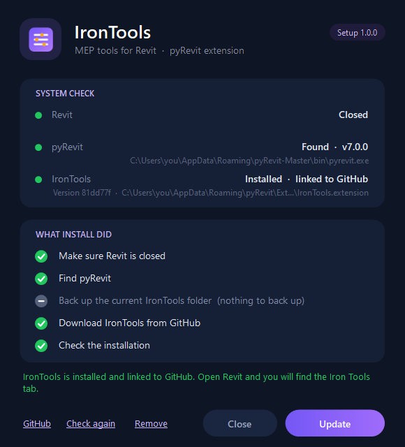</td>
  </tr>
</table>

### Update

Open **IronTools-Setup.exe** again and click **Update**, or in Revit click **pyRevit tab > Update**.
Revit can stay open; click **pyRevit > Reload** afterwards.

### Remove

Open **IronTools-Setup.exe** and click **Remove**. Nothing is deleted: the folder is moved to
`%APPDATA%\pyRevit\IronTools-Backups`, so you can bring it back.

<details>
<summary><b>Advanced: install with the pyRevit command line</b></summary>

```
pyrevit extend ui IronTools https://github.com/Ahmedzero800/IronTools.git
pyrevit extensions update IronTools
pyrevit extensions delete IronTools
```

The first line installs, the second updates, the third removes.
</details>

---

<div dir="rtl">

## التثبيت

لازم يكون **pyRevit** متسطب على جهازك.

1. **اقفل Revit.**
2. نزّل **[IronTools-Setup.exe](https://github.com/Ahmedzero800/IronTools/releases/latest/download/IronTools-Setup.exe)** وافتحه.
3. دوس **Install**، ولما كل الخطوات تبقى خضرا يبقى خلصت.
4. افتح Revit وهتلاقي تاب **Iron Tools**.

لو ظهرت رسالة **Windows protected your PC**: دوس **More info** وبعدين **Run anyway**.

**للتحديث:** افتح الملف تاني ودوس **Update**، أو من جوه Revit: تاب pyRevit ← **Update**.

**للإزالة:** افتح الملف ودوس **Remove**. الفولدر مش بيتمسح، بيتنقل لنسخة احتياطية.

</div>
